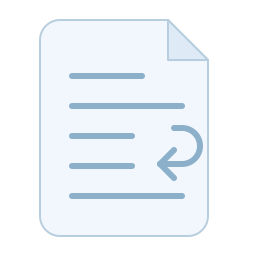

# ESLint Plugin Markdown Preferences Paragraph

[](https://github.com/dblock/eslint-plugin-markdown-preferences-paragraph/actions/workflows/test.yml) [](https://github.com/dblock/eslint-plugin-markdown-preferences-paragraph/actions/workflows/lint.yml) [](https://github.com/dblock/eslint-plugin-markdown-preferences-paragraph/actions/workflows/package.yml) [](https://coveralls.io/github/dblock/eslint-plugin-markdown-preferences-paragraph?branch=master)

An ESLint plugin for checking and safely fixing Markdown paragraph wrapping, inspired by [eslint-plugin-markdown-preferences#338](https://github.com/ota-meshi/eslint-plugin-markdown-preferences/issues/338).

## Installation

```sh
npm install --save-dev eslint @eslint/markdown eslint-plugin-markdown-preferences-paragraph@0.1.0
```

Requires Node.js 22.13 or a supported newer version, ESLint 9.39 or 10.x, and `@eslint/markdown` 8.x.

## Usage

In `eslint.config.js`:

```js
import markdown from "@eslint/markdown";
import paragraph from "eslint-plugin-markdown-preferences-paragraph";

export default [{
  files: ["**/*.md"],
  plugins: { markdown, paragraph },
  language: "markdown/gfm",
  rules: {
    "paragraph/paragraph-wrap": ["error", { width: 80 }],
  },
}];
```

Check Markdown paragraphs against an 80-column width:

```sh
npx eslint "**/*.md"
```

## Configuration

The rule accepts one option, `width`:

| Value | Behavior |
| --- | --- |
| Positive integer, such as `80` | Check paragraph width and safely reflow to that width. |
| `"nowrap"` | Check for soft line breaks and safely join them without a width limit. |
| `"ignore"` | Skip paragraph checks and fixes. |
| Omitted (default) | Skip paragraph checks and fixes. |

One width policy applies to every paragraph, including paragraphs in lists, blockquotes, and GFM footnotes. There are no container-specific widths, URL exemptions, or recommended presets.

Numeric widths include source markup and container prefixes, Unicode display width, and four-column tab stops.

## Fixing

Apply safe paragraph fixes with ESLint:

```sh
npx eslint "**/*.md" --fix
```

Numeric widths reflow paragraphs to the configured width; `"nowrap"` joins soft line breaks. Intentional hard breaks remain separate, and words, URLs, and inline constructs are never split. Unsafe or impossible corrections report without a fix; see [Fix Safety](DESIGN.md#integration-and-implementation).

Safe paragraph segments reflow even if their existing lines already fit: changing `width` from `30` to `80` fills the wider lines when fixing. Already canonical wrapping stays untouched.

## Interoperability

### [`markdown-preferences`](https://github.com/ota-meshi/eslint-plugin-markdown-preferences)

With the plugin registered as `markdownPreferences`, configure `max-len` to skip paragraphs at the root and in containers. For example, retain an 80-column heading limit:

```json
{
  "markdownPreferences/max-len": ["error", {
    "heading": 80,
    "paragraph": "ignore",
    "list": { "paragraph": "ignore" },
    "blockquote": { "paragraph": "ignore" },
    "footnoteDefinition": { "paragraph": "ignore" }
  }]
}
```

### [markdownlint](https://github.com/DavidAnson/markdownlint)

Disable markdownlint `MD013` when enforcing unrestricted `"nowrap"`. In `.markdownlint.json`:

```json
{
  "MD013": false
}
```

## Contributing

Read [Contributing](CONTRIBUTING.md), [Design](DESIGN.md), [Changelog](CHANGELOG.md), [Releasing](RELEASING.md), and [Automated Contributor Instructions](AGENTS.md).

## License

[MIT](LICENSE).
